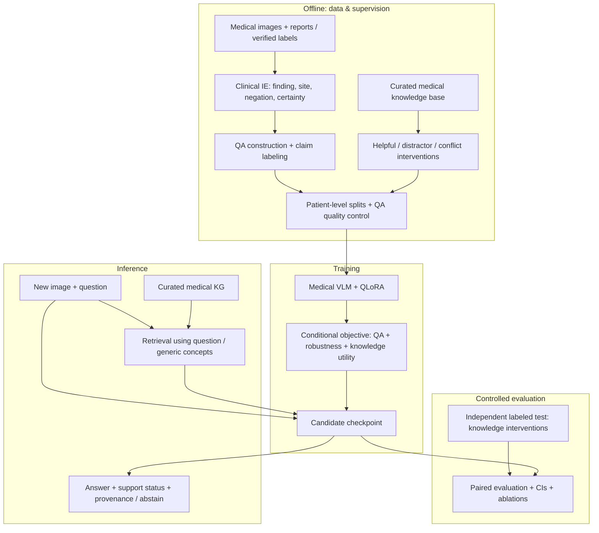

# CONDITIONAL KNOWLEDGE ALIGNMENT FOR EVIDENCE-GROUNDED MEDICAL VISUAL QUESTION ANSWERING

**Báo cáo nền tảng nghiên cứu và thiết kế khóa luận (Research Foundation Report)**  
**Tên ngắn đề xuất:** CKA-MedVQA / KNO-MedVQA (tên làm việc; **chưa kiểm tra trùng tên**)  
**Lĩnh vực:** Medical Visual Question Answering (MedVQA), Multimodal Learning, Medical NLP, Evidence-grounded Generation, Robustness  
**Định hướng:** Research-oriented; nghiên cứu phương pháp và giao thức đánh giá, không phải hệ thống chẩn đoán triển khai lâm sàng  
**Quy mô giả định:** 02 sinh viên Computer Science; 09–12 tháng; thiết bị cá nhân không có GPU huấn luyện mạnh; GPU thuê/cloud theo đợt  
**Ngày lập:** 20/10/2026  
**Ngôn ngữ:** Tiếng Việt, giữ các thuật ngữ quốc tế cần thiết  
**Trạng thái:** **ĐỀ XUẤT / CHƯA TRIỂN KHAI THỰC NGHIỆM**

> **Quy tắc đọc tài liệu:** Đây là *research proposal / working specification*, **không phải bài báo đã chứng minh một phương pháp mới**. Ký hiệu `[P]` = thông tin lấy từ paper có sẵn; `[H]` = giả thuyết hoặc thiết kế đề xuất; `[E]` = ước lượng dựa trên giả định; `[V]` = phải xác minh thêm. Không có số đo hiệu năng, chi phí thuê GPU, tính sẵn có của dataset hoặc khẳng định novelty nào được trình bày như đã kiểm chứng nếu chưa có thực nghiệm/đối chiếu tương ứng.
>
> **Giới hạn nguồn:** Báo cáo sử dụng các PDF đã cung cấp trong dự án và lập luận nghiên cứu; **không tra cứu Internet** theo yêu cầu trong cuộc trao đổi trước. Vì vậy, đây **không phải systematic literature review cập nhật toàn bộ công trình đến ngày 20/10/2026**. Trước khi nộp đề cương/paper, phải tiến hành kiểm chứng literature, model, dataset, license, pricing bằng nguồn chính thức và cập nhật phiên bản tài liệu này.

---

## MỤC LỤC

1. Executive summary và quyết định nghiên cứu
2. Bối cảnh và động lực
3. Phát biểu bài toán, giả định và phạm vi
4. Định nghĩa khoa học và mô hình hóa toán học
5. Tổng quan công trình liên quan và phân tích novelty
6. Giả thuyết nghiên cứu, câu hỏi và điều kiện bác bỏ
7. Kiến trúc tổng thể
8. Phương pháp đề xuất: Conditional Knowledge Alignment
9. Định nghĩa dữ liệu, nhãn và can thiệp tri thức
10. Dataset, nguồn tri thức và chuẩn hóa dữ liệu
11. Giao thức kiểm soát chất lượng và chống data leakage
12. Hệ mô hình, lựa chọn công nghệ và các phương án thay thế
13. Baseline, thí nghiệm và ablation
14. Metrics, thống kê và tiêu chí thành công
15. Kết quả kỳ vọng, kết quả thực tế và insight cần tìm
16. Dự toán compute, ngân sách, nhân lực
17. Lộ trình 8–10 tuần PoC và kế hoạch 12 tháng
18. Rủi ro, failure modes, đạo đức nghiên cứu
19. Kịch bản thành công/thất bại và pivot
20. Dạng đóng góp, chiến lược paper và checklist tái lập
21. Data schema và ví dụ minh họa
22. Câu hỏi chưa có lời giải, quyết định cần chốt
23. Từ điển thuật ngữ
24. Tài liệu tham khảo nội bộ

---

## 1. EXECUTIVE SUMMARY VÀ QUYẾT ĐỊNH NGHIÊN CỨU

### 1.1. Phát biểu một câu

**[H]** Nghiên cứu một cơ chế học *sự phụ thuộc có điều kiện vào tri thức y khoa ngoại sinh*: mô hình được hưởng lợi từ tri thức khi câu hỏi cần tri thức và trường hợp bệnh nhân cho phép áp dụng tri thức đó, nhưng không bị tri thức **đúng về mặt tổng quát nhưng không được ảnh cụ thể hỗ trợ** dẫn tới một câu trả lời sai.

### 1.2. Luận điểm khoa học cốt lõi

Có hai yêu cầu đối nghịch:

- **Conflict robustness**: câu trả lời dựa trên ảnh phải ổn định trước thông tin bên ngoài không liên quan, không đủ điều kiện áp dụng, hoặc mang tính đối kháng.
- **Knowledge utility**: với câu hỏi thực sự cần tri thức ngoài ảnh, hệ thống phải khai thác tri thức hữu ích và không được học chiến lược bỏ qua KG hoàn toàn.

**Một phương pháp chỉ cải thiện conflict robustness bằng cách luôn bỏ qua KG là nghiệm suy biến, không thành công.**

### 1.3. Đề xuất trọng tâm

1. **Định nghĩa một task và đánh giá can thiệp tri thức:** cho cùng ảnh–câu hỏi, thay đổi có kiểm soát nguồn tri thức; đo sự biến động đáp án, mức hữu dụng tri thức và hành vi từ chối.
2. **Xây bộ dữ liệu đa biến thể tri thức:** `helpful / irrelevant / applicable? / misleading / counterfactual` với nguồn xuất xứ và nhãn tin cậy rõ ràng.
3. **Huấn luyện Conditional Knowledge Alignment:** loss có điều kiện theo *loại câu hỏi* và *vai trò tri thức*, chứ không ép bất biến cho mọi câu hỏi.
4. **So sánh nghiêm khắc:** image-only, raw RAG, prompt ưu tiên ảnh, knowledge filtering/gating, SFT, hard-negative SFT, và công trình gần nhất có thể tái lập.

### 1.4. Tình trạng hiện tại

| Thành phần | Tình trạng |
|---|---|
| Phát biểu vấn đề | Có cơ sở từ DEPO, MCR và ProbMed `[P]` |
| Khoảng trống chính xác | **Giả thuyết cần kiểm chứng**, chưa được xác nhận là chưa ai giải quyết `[H/V]` |
| Thuật toán CKA | Đề xuất thiết kế; chưa có implementation đã kiểm tra `[H]` |
| Dataset conflict | Chưa tạo, chưa kiểm định `[H]` |
| Accuracy, CFR, robustness | **Chưa có kết quả** |
| Ước lượng GPU và tiền | Kịch bản lập ngân sách, không phải giá hiện tại `[E]` |
| Mục tiêu paper ACL | **Khả năng định hướng**, không phải cam kết chấp nhận |

### 1.5. Phán đoán chiến lược

- **Nên theo đuổi trước mắt:** PoC nhỏ, đo *failure mode* và giá trị của knowledge intervention.
- **Không nên làm ngay:** huấn luyện 7B/13B hàng loạt, xây KG đồ sộ, viết paper dựa trên pipeline ghép module hoặc tuyên bố độ tin cậy lâm sàng.
- **Điều kiện tiên quyết:** xác nhận visual capability của backbone và có test set đáng tin cậy. Nếu ảnh đã bị mô hình đọc sai, phần conflict learning rất khó được diễn giải đúng.

---

## 2. BỐI CẢNH VÀ ĐỘNG LỰC

### 2.1. Bài toán MedVQA truyền thống

MedVQA có đầu vào là một ảnh y khoa và câu hỏi tự nhiên, đầu ra là đáp án. Một số câu hỏi yêu cầu nhận diện trực tiếp: có dấu hiệu gì, bên nào, cấu trúc giải phẫu nào. Một số câu cần thêm kiến thức y khoa: ý nghĩa của finding, sự liên hệ giữa biểu hiện và cơ chế bệnh học.

VLM hiện đại có thể kết hợp ảnh và văn bản; knowledge augmentation (RAG/KG) có thể cải thiện khả năng trả lời câu hỏi cần kiến thức chuyên môn. Tuy nhiên, **tính đúng của một phát biểu y học ở mức thống kê quần thể không chứng minh nó đúng với một bệnh nhân cụ thể**.

### 2.2. Failure mode muốn nghiên cứu

Ví dụ giả định (không phải ca bệnh thực tế):

- Ảnh không đủ bằng chứng rõ ràng để xác nhận tràn dịch màng phổi phải.
- KG nêu một bệnh nền có thể liên quan đến tràn dịch màng phổi.
- Mô hình biến quan hệ `A có thể gây B` thành kết luận `bệnh nhân này có B`.

Ta gọi đây là **knowledge-induced unsupported inference** hoặc **knowledge–evidence conflict**, tùy tình huống. Cần phân biệt rất chặt:

- *Không thấy bằng chứng* ≠ *có bằng chứng phủ định*.
- *Knowledge is medically true* ≠ *knowledge is applicable to this patient*.
- *Image evidence conflicts with the claim* ≠ *retrieval contains factually false text*.
- *Question asks about generic medical facts* ≠ *question asks whether a patient has a finding*.

### 2.3. Vì sao accuracy thường là chưa đủ?

Một mô hình có thể đạt độ chính xác tốt bằng việc khai thác phân bố câu hỏi, prior bệnh phổ biến, hoặc cấu trúc văn bản mà không sử dụng đủ ảnh. ProbMed đặt vấn đề này qua các trường hợp adversarial probing; DEPO trực tiếp nhắm tới hallucination do lệch căn chỉnh ảnh–văn bản; MCR chỉ ra mô hình có thể đưa ra reasoning không nhất quán với visual evidence. `[P: R02, R03, R04]`

**Vì vậy, câu hỏi nghiên cứu không chỉ là “Accuracy tăng bao nhiêu?”, mà là “Accuracy đến từ bằng chứng nào, có bền vững trước tri thức gây nhiễu không, và khi nào tri thức thực sự hữu ích?”.**

---

## 3. PHÁT BIỂU BÀI TOÁN, GIẢ ĐỊNH VÀ PHẠM VI

### 3.1. Tên đề tài đề xuất

**English:** *Conditional Knowledge Alignment for Evidence-Grounded Medical Visual Question Answering*.

**Tiếng Việt:** *Căn chỉnh tri thức có điều kiện dựa trên bằng chứng cho bài toán hỏi đáp hình ảnh y khoa*.

**Tên framework tùy chọn:** `CKA-MedVQA`. Đây là tên tạm, phải kiểm tra trùng tên/viết tắt khi công bố.

### 3.2. Problem statement chính thức

Cho một Medical VLM dự đoán đáp án từ ảnh `I`, câu hỏi `q` và tập tri thức truy xuất `K`. Trên các câu hỏi quan sát hình ảnh, khi thay `K` bằng nội dung đúng nhưng không áp dụng cho ảnh, đáp án không nên chuyển từ đúng sang sai. Trên câu hỏi cần kiến thức, `K` đúng, đủ căn cứ và áp dụng được phải cải thiện trả lời so với không có tri thức.

**Bài toán tối ưu:** tăng chất lượng đáp án cùng với **khả năng sử dụng tri thức có chọn lọc** và **độ vững trước tri thức không áp dụng**, dưới ràng buộc dữ liệu, tính toán và chất lượng nhãn.

### 3.3. Scope đề xuất theo mức

| Cấp | Task/ảnh | Mục tiêu | Trạng thái |
|---|---|---|---|
| MVP | Ảnh X-quang ngực; binary VQA / finding / laterality | Xác minh failure mode và metrics | **Bắt buộc trước khi mở rộng** |
| Thesis core | Thêm knowledge-dependent questions, uncertainty, knowledge interventions | Kiểm chứng method CKA | **Trọng tâm** |
| Paper extension | Dataset khác, ít nhất 2 backbone nếu được, unseen combinations | Khẳng định tính tổng quát | **Tùy nguồn lực** |
| Ngoài phạm vi | Chẩn đoán lâm sàng tự động, điều trị, khuyến cáo bệnh nhân | Không thực hiện | **Loại trừ** |

### 3.4. Các loại câu hỏi

| Nhóm | Ví dụ giả định | Phụ thuộc ảnh | Phụ thuộc tri thức |
|---|---|---:|---:|
| `visual_fact` | “Có tràn dịch màng phổi phải không?” | Cao | Thấp |
| `localization` | “Bất thường được báo cáo ở bên nào?” | Cao | Thấp |
| `knowledge_reasoning` | “Finding này có thể liên quan đến cơ chế bệnh lý nào?” | Cao | Cao |
| `applicability` | “Quan hệ bệnh A → dấu hiệu B có đủ để kết luận B có trên ảnh này?” | Cao | Cao |
| `insufficient_evidence` | “Ảnh này đủ xác nhận nguyên nhân gây bất thường không?” | Cao | Có thể có |
| `question_intervention` | Đổi phủ định, vị trí, entity trong câu hỏi | Cao | Biến thiên |

**Chú ý thiết kế:** một số câu knowledge-dependent chỉ hỏi tri thức tổng quát, không kiểm tra ảnh; nên tách ra thành negative/control tasks thay vì đếm chung với evidence-grounded reasoning.

### 3.5. Các giả định phải tuyên bố

- Có thể tiếp cận một lượng ảnh y khoa hợp pháp kèm nhãn visual finding có giá trị.
- Có một tập tri thức chuyên ngành nhỏ, truy vết được nguồn và mức chắc chắn.
- Có thể tạo tập evaluation độc lập, ít nhất phần cốt lõi không dựa vào LLM tự chấm chính mình.
- Backbone có năng lực nhận biết hình ảnh cơ bản; nếu không, phân tích knowledge conflict trở nên khó diễn giải.
- Các tri thức ở thời điểm suy luận không chứa báo cáo tham chiếu, đáp án hoặc nhãn được lấy từ test image.

---

## 4. ĐỊNH NGHĨA KHOA HỌC VÀ TOÁN HỌC

### 4.1. Ký hiệu

| Biến | Ý nghĩa |
|---|---|
| `I` | Ảnh y khoa, có thể là một ảnh CXR frontal ở MVP |
| `q` | Câu hỏi |
| `K` | Tri thức ngoại sinh được truy xuất; không phải báo cáo test tương ứng |
| `E` | Biểu diễn bằng chứng hình ảnh (ẩn hoặc dự đoán) |
| `t` | Loại câu hỏi; ví dụ visual-only / knowledge-dependent |
| `r` | Nhãn vai trò/applicability của tri thức |
| `a` | Đáp án hoặc nhãn chuẩn hóa |
| `u` | Trạng thái supported / contradicted / unknown; có thể thêm abstain |
| `f_theta` | Medical VLM với tham số θ |
| `g_phi` | Bộ ước lượng evidence/knowledge applicability (tùy kiến trúc) |

Hàm dự đoán:

```math
(\hat a, \hat u, \hat e) = f_{\theta}(I,q,K)
```

Trong đó `e` là bằng chứng được xuất ra và **không mặc nhiên được coi là lời giải thích trung thực của cơ chế nội bộ**. Nếu muốn khẳng định *faithfulness*, cần thí nghiệm can thiệp độc lập.

### 4.2. Định nghĩa đúng mức độ của một nhãn quan sát

Với một mệnh đề lâm sàng `c` liên quan trực tiếp đến ảnh:

`visual_status(c,I) ∈ {supported, contradicted, unknown}`.

Với quan hệ tri thức `k`:

`knowledge_status(k) ∈ {valid, false, uncertain}` và `applicability(k,I,q) ∈ {applicable, irrelevant, unsupported, unknown}`.

**Bắt buộc tách `valid` và `applicable`:** một tri thức có thể valid nhưng unsupported trong ca ảnh cụ thể.

### 4.3. Conditional knowledge reliance

Ý tưởng toán học: mô hình phải học một mức độ phụ thuộc tri thức **khác nhau theo loại câu hỏi và điều kiện quan sát**. Với câu hỏi trực quan có đáp án được xác minh, thay đổi tri thức không áp dụng không nên thay đổi đáp án. Với câu hỏi cần tri thức, thay đổi tri thức phù hợp có thể thay đổi độ đúng, độ đầy đủ hoặc trạng thái abstain.

Không áp đặt bất biến tuyệt đối cho mọi `K` vì làm vậy sẽ tạo mô hình bỏ qua tri thức.

### 4.4. Các đại lượng nên phân biệt

1. **Raw accuracy:** tỷ lệ đáp án đúng trên nhóm câu hỏi có tham chiếu.
2. **Conflict robustness:** khả năng không bị thay đổi từ đúng → sai khi thêm nhiễu kiến thức.
3. **Knowledge utility:** lợi ích thực sự từ tri thức liên quan trên câu hỏi cần tri thức.
4. **Selective reliability:** mô hình từ chối đúng chỗ mà không triệt tiêu coverage.
5. **Grounding evidence:** câu trả lời có liên hệ với ảnh theo phép kiểm tra độc lập; không suy ra chỉ từ fluency của rationale.

---

## 5. RELATED WORK: ĐÃ CÓ GÌ VÀ KNO PHẢI KHÁC Ở ĐÂU?

### 5.1. Ma trận đối chiếu các công trình quan trọng

| Mã | Công trình | Đã làm gì (theo paper trong Project) | Ý nghĩa / khoảng trống cần xác minh |
|---|---|---|---|
| **R01** | **MedKInstruct** | Multimodal knowledge graph để tạo multi-hop & hard-negative instruction; reward liên quan KG path; báo cáo tăng 4.16% trên SLAKE và 4.50% trên VQA-RAD so với baseline được paper chọn `[P]` | KG + synthetic QA + hard-negative **không còn là novelty tự thân**. Kiểm tra logic *tri thức đúng nhưng không áp dụng* ở cấp ca ảnh. |
| **R02** | **DEPO / Beyond Surface Features** | Dynamic Evidence-guided Preference Optimization với perturbation ảnh/văn bản, resampling negative; nhắm hiện tượng mô hình ưu tiên văn bản hơn ảnh `[P]` | **Đối thủ gần nhất.** Không được tuyên bố lần đầu chống knowledge override. Phải chứng minh vai trò *knowledge utility & conditional intervention* khác biệt. |
| **R03** | **Act as You Think / MCR** | Reward cho consistency giữa perception, reasoning, answer; chỉ ra failure mode khi RLVR bỏ qua ảnh `[P]` | Output consistency không tự động chứng minh knowledge applicability; cần compare nếu phù hợp. |
| **R04** | **Worse than Random? / ProbMed** | Probing với cặp đối kháng; phát hiện LMM có thể xử lý kém các câu hỏi chẩn đoán bị nhiễu `[P]` | Chỉ tăng accuracy benchmark chuẩn không đủ; cần controlled tests. |
| **R05** | **Exploring Compositional Generalization / Med-MAT** | Thiết kế bài toán generalization trên modality × anatomical area × task `[P]` | Việc kiểm tra unseen combinations đã có tiền lệ; phải chỉ rõ split can thiệp tri thức khác gì. |
| **R06** | **MedThink** | Rationale-guided medical VQA; datasets có rationale bổ sung `[P]` | Reasoning explanation/rationale không phải đóng góp độc quyền của KNO. |
| **R07** | **A3Tune / Focus on What Matters** | Attention alignment tuning cho medical VLM `[P]` | Heatmap/attention không đủ chứng minh đáp án phụ thuộc bằng chứng. |
| **R08** | **MedVP / Explicit Visual Prompts** | Dùng prompt hình ảnh để định hướng vùng quan tâm `[P]` | Visual prompting đã có; KNO không nên đóng góp bằng ROI prompt đơn giản. |
| **R09** | **MMCAP** | Concept alignment pre-training tận dụng medical KG `[P]` | Bổ sung KG vào MedVQA không mới. |
| **R10** | **STLLaVA-Med** | Self-training, preference/data efficiency trên medical VQA `[P]` | Tạo dữ liệu + preference-based training đã có nền tảng. |
| **R11** | **OmniMedVQA** | Benchmark nhiều modality; PDF mô tả 12 modalities, 118,010 images, 127,995 QA items `[P]` | Scope rộng có ích cho ngoại suy, nhưng không nhất thiết phù hợp protocol xung đột. |
| **R12** | **WorldMedQA-V** | Benchmark y khoa đa ngôn ngữ, đa phương thức `[P]` | Kiểm tra generalization ngôn ngữ có thể bổ trợ. |
| **R13** | **PathVQA** | Benchmark VQA ảnh bệnh học `[P]` | Đánh giá modality khác khi mở rộng. |
| **R14** | **PubMedCLIP** | Ứng dụng domain CLIP trong MedVQA `[P]` | Backbone adaptation là baseline, không phải novelty chính. |
| **R15** | **Fusion of Domain-Adapted Vision and Language Models** | Kết hợp mô hình ảnh và ngôn ngữ thích nghi domain `[P]` | So với pipeline fusion nếu chọn thiết kế modular. |
| **R16** | **MasonNLP at MEDIQA-WV 2025** | Multimodal RAG trong wound-care VQA `[P]` | Retrieval + generation là thực hành đã có. |
| **R17** | **X-FLoRA** | Cross-modal federated learning với modality-expert LoRA `[P]` | Không trực tiếp nhắm conflict; liên quan compute/PEFT và modality. |

**Lưu ý cẩn trọng:** các tóm tắt trên phản ánh nội dung paper đã tải lên, **không phải phân tích toàn diện mọi ablation/appendix**. Bắt buộc đọc lại method, training details, licenses, supplementary/code trước khi chọn làm baseline chính.

### 5.2. Novelty collision — mức độ rủi ro

- **Rất cao:** “thêm KG để sinh câu hỏi khó” (R01/R09), “giảm hallucination bằng evidence perturbation và preference” (R02), “thưởng consistency” (R03).
- **Cao:** “dùng attention/ROI để hướng ảnh” (R07/R08), “test adversarial bằng phủ định” (R04), “benchmark tổ hợp chưa gặp” (R05).
- **Có tiềm năng nhưng chưa chứng minh:** *jointly optimize knowledge utility and conflict robustness under applicability-conditioned interventions*; cần tìm bằng chứng đây có thực sự khác các phương pháp knowledge filtering/selection/causal interventions.

### 5.3. Research gap viết theo chuẩn có thể bác bỏ

**Gap (giả thuyết, không phải fact):** các phương pháp hiện tại chưa được chứng minh đầy đủ về **khả năng kiểm soát ảnh hưởng có điều kiện của tri thức ngoại sinh ở cấp ảnh–câu hỏi** trong MedVQA, đặc biệt khi tri thức đúng tổng quát nhưng không được hình ảnh hỗ trợ, và đồng thời vẫn bảo toàn lợi ích trên câu hỏi cần tri thức.

**Điều kiện gap không còn đứng vững:** tìm được paper trước đó đã định nghĩa/chứng minh đầy đủ bài toán này với intervention protocol, conditional objective và kết quả robust–utility; lúc đó cần thay đổi novelty claim hoặc pivot.

### 5.4. Ba câu hỏi phải trả lời khi tự phản biện

1. Cơ chế của ta khác gì việc gọi retrieval rồi thêm NLI filter? Nếu tương đương, **novelty thấp**.
2. Có chứng minh model *không bỏ qua knowledge* không? Nếu không, **thất bại task gốc**.
3. Nhãn *image support* có đủ tin cậy để gọi là visual grounding không? Nếu chỉ dùng báo cáo giả lập QA, **kết luận nhân quả yếu**.

---

## 6. RESEARCH QUESTIONS, HYPOTHESES, FALSIFICATION

| Mã | Câu hỏi | Giả thuyết kiểm chứng | Cách bác bỏ |
|---|---|---|---|
| **RQ1/H1** | Tri thức gây nhiễu có làm VLM đổi đáp án đúng từ ảnh thành sai? | Thêm một số loại `K` không phù hợp làm tăng *wrong flips* ở baseline | Không có thay đổi có ý nghĩa hoặc khác biệt chỉ do lỗi prompt/format |
| **RQ2/H2** | Objective có điều kiện cải thiện robustness hơn SFT/filter đơn giản? | CKA giảm CFR trên conflict test độc lập với cùng backbone/compute | Không tốt hơn strong baselines khi kiểm soát tài nguyên |
| **RQ3/H3** | CKA giữ được lợi ích tri thức? | Knowledge-dependent QA không mất utility so với raw KG/SFT | Model giảm CFR bằng cách bỏ qua KG; KUG ≤ 0 trên nhóm cần KG |
| **RQ4/H4** | Tăng độ tin cậy khi thiếu bằng chứng? | Risk tại một mức coverage đặt trước giảm | Risk giảm chỉ do coverage về quá thấp, calibration kém |
| **RQ5/H5** | Kết quả khái quát ngoài conflict templates? | Cải thiện trên split theo ảnh, thực thể, template hoặc nguồn khác | Chỉ hiệu quả với negatives đã thấy hoặc split rò rỉ |

**Primary hypothesis (khuyến nghị):** H2 **và** H3 phải cùng có bằng chứng. H1 là tiền đề để nghiên cứu hợp lý; H4/H5 là kiểm chứng mở rộng.

---
## 7. KIẾN TRÚC TỔNG THỂ (ENGINEERING VIEW)

### 7.1. Phân tách training và inference



**Ranh giới chống leakage:** report của ảnh test, answer labels, verified test findings và annotated per-image KG path **chỉ được dùng để chấm, không được đưa vào retriever/inference**. Một KG thuần *medical knowledge general* khác với một *image-specific graph* chứa đáp án. Cần phân biệt rõ hai loại này trong code và bảng kết quả.

### 7.2. Module contract (input/output)

| Module | Input | Output | Vai trò | Điểm lỗi cần theo dõi |
|---|---|---|---|---|
| Image loader | path/DICOM, metadata cho phép | tensor / pixel array | Ảnh đúng modality, orientation | resize mất dấu hiệu, đảo trái/phải, data leakage |
| Question parser | văn bản câu hỏi | type, entities, requested assertion | Nhận diện câu hỏi visual/knowledge | rule lệch ngôn ngữ, negation sai |
| Clinical IE (offline) | báo cáo đã tách split | finding propositions | Tạo weak supervision | bỏ sót uncertainty, hallucination từ IE |
| Knowledge curator | ontology/triples | triples có provenance, qualifier | Tri thức bên ngoài | nhầm quan hệ causation và association |
| Knowledge retriever | question + generic concepts | top-k triples | Chọn thông tin có khả năng liên quan | “oracle” truy vấn bằng ground-truth report |
| Evidence representation | image + q | finding estimates / uncertainty | Có cơ sở về quan sát | underperformance, overconfidence |
| Conditional alignment | I,q,K,type | answer distributions / support | Điều chỉnh phụ thuộc tri thức | model bỏ KG hoặc lệch gate |
| Output formatter | model output | answer, evidence status, abstain | Chuẩn hóa QA | tạo rationale nghe hợp lý nhưng không đáng tin |
| Evaluator | predictions + independent labels | metrics, CIs, error slices | Kiểm tra giả thuyết | contamination, matched-pair errors |

### 7.3. Hai cấu hình kiến trúc thực tế

**Architecture A — Minimalist / recommended MVP:** một VLM, bộ truy xuất KG nhỏ, không cần external verifier tại inference. Huấn luyện theo các điều kiện tri thức và phân phối answer tokens chuẩn hóa. Ít module, dễ ablation; novelty phải đến từ objective/protocol.

**Architecture B — Modular / extension:** visual evidence model + retriever + applicability estimator + generator. Dễ giải thích luồng xử lý hơn và thử lỗi từng module, nhưng pipeline dài, lỗi lan truyền, khó giữ công bằng compute so sánh. *Không chọn B trước khi A cho kết quả rõ.*

---

## 8. PHƯƠNG PHÁP ĐỀ XUẤT — CONDITIONAL KNOWLEDGE ALIGNMENT

### 8.1. Ý tưởng: học **sử dụng đúng lúc**, không chỉ học **chống nhiễu**

Trong huấn luyện, tạo nhiều “điều kiện thông tin” cho **cùng ảnh và câu hỏi**:

- `K_0`: không có tri thức bổ sung (image-only).
- `K_h`: tri thức y khoa được xác minh và **phù hợp với loại câu hỏi**; chỉ là *applicable to image* nếu điều đó được nhãn hỗ trợ.
- `K_d`: tri thức thật nhưng không liên quan/không áp dụng; có thể *plausible distractor*.
- `K_c`: tri thức sai hoặc khẳng định phản thực; chỉ dùng trong thí nghiệm có đánh dấu an toàn.
- `K_m`: tri thức thiếu/mơ hồ (missing evidence).

**Không phải mọi `K_h` đều phải làm đáp án thay đổi.** Với câu visual-only, tri thức hữu ích có thể giúp ngôn ngữ diễn đạt nhưng đáp án nhận định finding vẫn lấy từ ảnh. Với câu knowledge-dependent, tri thức chính xác có thể làm mô hình trả lời được một câu trước đó phải từ chối.

### 8.2. Mẫu dữ liệu huấn luyện

```text
Input  = (image_id, image, question, knowledge_context, question_type)
Target = (answer, optional_support_status)
Meta   = (knowledge_role, source_provenance, applicability_label,
          answer_verification, split_id, image/patient_group)
```

**Quy tắc quan trọng:** `knowledge_role` và `applicability_label` có thể dùng làm supervision lúc train; ở inference không giả sử model nhận được nhãn này từ oracle. Nếu kiến trúc có gate thì gate phải **tự dự đoán** mức applicability từ thông tin được phép truy cập.

### 8.3. Objective khả thi hơn cho PoC

Để tránh KL trên toàn bộ chuỗi sinh, đặt một tập nhãn `Y_q` hữu hạn cho câu hỏi chuẩn hóa (ví dụ `yes/no/unknown`, hoặc danh sách finding/laterality được giới hạn). Tính xác suất nhãn bằng log-likelihood của chuỗi đáp án chuẩn hóa hoặc classification head.

Giả sử `pθ(y | I,q,K)` là phân phối nhãn, `v_i=1` nếu QA đó là visual-dominant và có nhãn chắc chắn, `d_i=1` nếu tri thức đang sử dụng là distractor không áp dụng. Đề xuất:

```math
L_total = L_answer + \lambda_v L_visual_robust + \lambda_k L_knowledge_utility + \lambda_u L_uncertainty
```

**(i) L_answer — supervised answer loss.**

```math
L_answer = - E_{(I,q,K,y)} [log p_theta(y | I,q,K)]
```

Các mẫu huấn luyện phải có đáp án xác minh; weak labels có thể có weights nhỏ hơn hoặc bị loại nếu độ tin cậy thấp.

**(ii) L_visual_robust — giữ đáp án trên visual-only khi tri thức không áp dụng.**

Đối với những mẫu `v_i=d_i=1`, chọn phân phối tham chiếu `p_ref(y | I,q)` từ image-only branch hoặc teacher snapshot đáng tin cậy. Dùng KL *hoặc* CE theo nhãn chuẩn:

```math
L_visual_robust = E_{i: v_i d_i = 1}
  KL( stopgrad[p_ref(. | I_i,q_i)] || p_theta(. | I_i,q_i,K_d) )
```

**Cảnh báo:** nếu `p_ref` sai, distillation có thể bảo toàn sai số. Ưu tiên nhãn chuẩn/teacher chỉ trên các trường hợp baseline image-only **đúng và đủ tin cậy**; kiểm tra selection bias do điều kiện này. Có thể thay bằng CE theo `y_i` đối với các mẫu adversarial được xác minh (giải pháp đơn giản, baseline mạnh).

**(iii) L_knowledge_utility — không cho phép nghiệm bỏ KG.**

Trên QA knowledge-dependent đã được xác minh, ưu tiên `K_h` và dạy đáp án mục tiêu; với `K_0` hoặc `K_m` thiếu thông tin, **không áp đặt một câu trả lời sai**, mà giám sát `unknown/abstain` nơi phù hợp. Dạng tối giản:

```math
L_knowledge_utility =
    E_{i: t_i=knowledge_required} [CE(y_i, p_theta(.|I_i,q_i,K_h))]
  + beta * E_{i: genuinely_unanswerable_without_K} [CE(abstain, p_theta(.|I_i,q_i,K_0))]
```

Dòng thứ hai chỉ được kích hoạt nếu người gán nhãn xác nhận **không đủ dữ liệu trong ảnh và prompt**. Không suy ra “cần KG” chỉ vì baseline image-only trả lời sai; đó có thể đơn thuần là model kém.

**(iv) L_uncertainty — học trạng thái bằng chứng.**

```math
L_uncertainty = CE(visual_status, predicted_visual_status)
```

Chỉ áp dụng khi có `supported / contradicted / unknown` được kiểm chứng. Nếu không có ground truth đáng tin cậy, **không dùng loss này trong MVP**; đánh giá uncertainty theo answer abstention thay thế.

**Lưu ý nghiên cứu:** đây là *family of objectives*, chưa có chứng minh loss tối ưu/tính hội tụ. Một phần innovation dự kiến phải được xác định từ kiểm chứng empirical: conditional weighting/gating/hardness sampling nào thật sự tốt hơn CE baseline.

### 8.4. Phương án nâng cao: applicability-gated fusion

Thử học trọng số `g_phi(I,q,K) ∈ [0,1]` cho việc dùng KG:

```math
z = z_visual(I,q) + g_phi(I,q,K) * z_knowledge(I,q,K)
```

`z` biểu diễn feature hoặc logits theo thiết kế cụ thể. Có thể thêm prior `g≈0` khi distractor, `g>0` khi tri thức thực sự cần; tuy nhiên **phải chứng minh gate không chỉ học shortcut từ văn phong K hoặc loại câu hỏi**. Đánh giá bằng shuffle K, paraphrase, unseen entity và modality controls.

**Không tự động coi gating là novelty.** Gating/fusion đã có lịch sử lâu dài. Novelty nếu có phải ở formulation + supervision + behavior được kiểm chứng.

### 8.5. Counterfactual và contrastive: định nghĩa chặt

- **Knowledge intervention:** giữ ảnh, câu hỏi và nhãn đúng cố định; đổi `K`. Đây là thí nghiệm can thiệp vào **đầu vào tri thức của mô hình**, không phải chứng minh nhân quả trong sinh bệnh học.
- **Question perturbation:** đổi phủ định, vị trí, entity hoặc quantifier; thường đáp án chuẩn **phải được gán nhãn lại**, không mặc định giữ nhãn.
- **Paired distinct images:** hai ảnh bệnh nhân có nhãn khác nhau; chỉ là cặp *contrastive*, không phải counterfactual image theo định nghĩa nhân quả.
- **Image masking/cropping:** làm mờ hoặc mất thông tin; **không được coi là tạo ra một ảnh “không có bệnh”**.
- **Synthetic image editing:** cần chứng minh giữ được tính hợp lệ y khoa trước khi khẳng định causal visual counterfactual.

### 8.6. Tại sao không bắt đầu bằng RL / DPO / GRPO?

- Training và reward engineering phức tạp hơn; tiêu thụ nhiều GPU/inference rollouts.
- R02 và R03 đã khai thác preference/evidence perturbation, consistency reward, nên overlap lớn.
- Với nhóm 2 sinh viên và ngân sách giới hạn, trước tiên phải chứng minh cơ chế supervised conditional learning có hiệu quả **ngoài tăng dữ liệu**.

**Lộ trình đúng:** SFT/QLoRA + conditional loss → mạnh hơn prompt/filter baselines → nếu đủ tài nguyên mới cân nhắc DPO/GRPO như phần mở rộng (không phải điều kiện hoàn thành thesis).

### 8.7. Pseudocode triển khai PoC

```python
for batch in train_loader:
    # One group includes the same (image, question) with controlled K variants.
    # Important: reference answer and task labels are independently validated.
    image, question, answer = batch.image, batch.question, batch.answer
    k_help, k_dist = batch.knowledge_helpful, batch.knowledge_distractor

    logits_help = model(image, question, k_help)
    logits_dist = model(image, question, k_dist)
    logits_none = model(image, question, knowledge=None)

    l_answer = CE(logits_help, answer)
    l_robust = masked_CE(logits_dist, answer, mask=batch.is_verified_visual)
    l_utility = knowledge_needed_loss(
        logits_help, logits_none,
        mask=batch.is_verified_knowledge_required,
        target=batch.answer_or_valid_abstention
    )

    loss = l_answer + lambda_v * l_robust + lambda_k * l_utility
    loss.backward()
    optimizer.step()
    optimizer.zero_grad()
```

Pseudocode chỉ để minh họa hướng triển khai. Không phải mã có thể chạy ngay: cần định nghĩa tokenizer/answer normalization, batch packing, masking, CE trên nhãn, gradient accumulation, AMP và trainable parameters.

---

## 9. THIẾT KẾ DỮ LIỆU CAN THIỆP TRI THỨC

### 9.1. Năm loại kiến thức phải tách biệt

| Ký hiệu | Đặc điểm | Dự kiến câu trả lời visual-only | Cách dùng |
|---|---|---|---|
| `K_h` Helpful | Đúng, liên quan, có giá trị cho câu hỏi | Giữ đúng finding từ ảnh | Kiểm tra utility |
| `K_ir` Irrelevant | Đúng nhưng không liên quan | Giữ nguyên | Robustness basic |
| `K_na` Not applicable | Đúng và liên quan trong y học, nhưng không được chứng minh cho ảnh cụ thể | Không tự suy diễn finding | **Core research stress test** |
| `K_cf` Counterfactual/false assertion | Chứa giả định sai hoặc gây mâu thuẫn được gán nhãn | Không bị dẫn sai | Adversarial control, phải cách ly |
| `K_m` Missing/ambiguous | Thiếu yếu tố then chốt | Có thể trả lời visual-only, abstain nếu thiếu tri thức thực sự | Test uncertainty |

**Phân biệt `K_na` với `K_cf`:** `K_na` thường **không phải kiến thức sai**. Đây là nhóm quan trọng nhất vì gây suy luận quá mức mà vẫn có vẻ hợp lý.

### 9.2. Đơn vị đánh giá — *intervention group*

Một đơn vị gồm:

```text
group_id: G_001
image: CXR_001
question: Q_001
ground_truth_visual: supported/contradicted/unknown (if verified)
reference_answer: yes/no/unknown (if verified)
variants:
   - no_kg
   - helpful_kg
   - irrelevant_kg
   - not_applicable_kg
   - conflicting_kg
```

Tất cả biến thể trong một nhóm **phải nằm cùng split**. Chia ngẫu nhiên theo QA variant là leakage nghiêm trọng.

### 9.3. Ràng buộc xây negative chất lượng

- Giữ nguyên ảnh và ý định câu hỏi khi kiểm tra ảnh hưởng K.
- Không đưa đáp án hoặc report của image test vào `K`.
- Cho `K_na` có mức độ liên quan từ vựng **tương đương** `K_h` nếu khả thi; nếu không, model chỉ học từ khóa.
- Cân bằng độ dài, vị trí trong prompt, thứ tự triple, cách diễn đạt, tần suất answer.
- Có “hard positive” (tri thức hữu ích ít từ khóa trùng) để không biến hard negative thành test lexical match.
- Ghi provenance, relation type (`associated_with`, `may_cause`, `causes`, `suggests`, ...), modality và context qualifiers.
- Tránh ép mọi quan hệ y khoa phức tạp thành quan hệ nhân quả chắc chắn.

### 9.4. Gắn nhãn confidence và xuất xứ

`label_source` phải thuộc các giá trị như `expert_reviewed`, `dataset_label`, `report_derived`, `rule_generated`, `llm_proposed`. Không gộp toàn bộ thành “ground truth”.

Đặc biệt, `report_derived` = giám sát yếu cho ảnh nếu chưa được xác minh; `llm_proposed` = đề xuất nhãn cần kiểm tra; `expert_reviewed` không đồng nghĩa với tuyệt đối đúng nhưng có thể là chuẩn đánh giá mạnh hơn.

---

## 10. DATA SOURCES, KIẾN THỨC VÀ TIỀN XỬ LÝ

### 10.1. Vai trò của từng nguồn

| Nguồn ứng viên | Dữ liệu chính | Vai trò | Những gì **chưa xác minh trong phiên này** |
|---|---|---|---|
| **ViX-Ray** | Dự kiến ảnh X-quang và báo cáo tiếng Việt | Phù hợp mục tiêu VN CXR VQA | Bản phát hành/version, số mẫu chính thức, split, license, quyền tải và khả năng dùng commercial/research `[V]` |
| **VQA-RAD** | Medical VQA trên ảnh radiology | Benchmark phụ / transfer | Tải, giấy phép, câu hỏi phù hợp và split phải kiểm tra `[V]` |
| **SLAKE** | Medical VQA có yếu tố tri thức | Benchmark phụ; related work gần R01 | Điều kiện dùng, ontology/split và contamination phải kiểm tra `[V]` |
| **MIMIC-CXR** | Ảnh và báo cáo CXR | Data extension hoặc pretrained evidence labels nếu hợp lệ | Điều kiện truy cập, licensing, IRB/data agreement `[V]` |
| **CheXpert** | CXR + labels findings/uncertainty | Visual finding supervision/validity | Terms, labels và adaptation `[V]` |
| **VinDr-CXR** | CXR + bất thường/vị trí (tùy bản) | Independent grounding checks | Data availability và labels `[V]` |
| **OmniMedVQA** | Nhiều modality/QA | Cross-domain benchmark mở rộng | Scope mismatch và legal terms `[V]` |
| **RadLex/UMLS/SNOMED CT** | Terminology/ontologies | Entity normalization + small KG | Licensing và loại quan hệ hợp lệ khác nhau `[V]` |

**Vì chưa truy cập web**, không cung cấp đường tải hay giá trị size hiện hành không được đối chiếu. Thông tin sơ bộ trong PDF R11 cho biết OmniMedVQA nêu 12 modalities, 118,010 images và 127,995 QA; đây là số từ paper, không phải kiểm tra bản tải thực tế.

### 10.2. Dữ liệu tối thiểu thực tế cho PoC

Đề xuất kế hoạch **mục tiêu thiết kế** `[E]`:

| Đầu ra dữ liệu | Quy mô mục tiêu | Điều kiện |
|---|---:|---|
| Ảnh đã lọc | 500–1,000 | Chỉ dùng nếu source hợp lệ, không trùng ảnh |
| QA visual có nhãn chắc chắn | 300–600 | Có cân bằng yes/no/unknown hợp lý |
| QA knowledge-dependent | 150–300 | Có bằng chứng câu hỏi thật sự cần K |
| Intervention groups cho pilot | 100–250 | Mỗi group có 3–5 biến thể K |
| Set độc lập để đánh giá ban đầu | 100–200 group | Không dùng để tối ưu prompt/hyperparameters |

**Thesis target** (nếu PoC thành công): 2,000–4,000 ảnh; 6,000–12,000 QA; 10,000–25,000 variants; 300–600 independent QA, có thể thêm subset expert-reviewed. Đây hoàn toàn là **mục tiêu cần đạt**, không phải số liệu đã sản xuất.

### 10.3. Data processing từng bước

1. **License & eligibility audit:** kiểm tra mục đích sử dụng, phân quyền, metadata nhạy cảm, chính sách chia sẻ ảnh/weights.
2. **Dedup & patient grouping:** hash ảnh, perceptual similarity khi cần; lấy patient/study ID nếu hợp lệ; luôn split theo patient nếu có.
3. **Image normalization:** kiểm tra orientation, view (PA/AP/lateral), kích thước, mức xám; không tùy tiện flip trái/phải khi câu hỏi hỏi laterality.
4. **Report parsing (offline):** tách findings/impression; lọc dữ liệu hành chính, dấu hiệu phủ định/không chắc chắn.
5. **Clinical IE:** chuẩn hóa một ontology finding/anatomy/laterality/polarity/certainty tối thiểu.
6. **KG curation:** chỉ giữ quan hệ có bằng chứng/nguồn; thêm qualifier như `may`, `associated_with`, `not_sufficient_for_diagnosis`.
7. **QA generation:** template cho visual QA; người/LLM hỗ trợ đề xuất knowledge QA nhưng không tự nhận nhãn đáng tin.
8. **Intervention generation:** tạo K variants dựa trên tri thức, giữ ngữ cảnh, gắn role và provenance.
9. **Quality filtering:** logical consistency, duplication, leakage, language normalization, class balance.
10. **Evaluation curation:** tập test có nhãn độc lập; chưa có nhãn chắc chắn thì mark unknown/exclude khỏi core metrics.

### 10.4. Clinical information representation

Một proposition tối thiểu:

```json
{
  "concept": "pleural_effusion",
  "anatomy": "right_pleura",
  "polarity": "positive",
  "certainty": "probable",
  "evidence_source": "radiology_report",
  "verification": "not_independently_verified"
}
```

Không suy ra từ `polarity=positive` rằng model visual recognition đã đúng. Nhãn báo cáo là *weak supervision* trừ khi có đánh giá độc lập.

### 10.5. KG nên nhỏ nhưng chất lượng

MVP chỉ cần tri thức của một số finding phổ biến phù hợp dataset. Mục tiêu không phải xây KG càng lớn càng tốt. Mỗi triple nên có:

- `subject / relation / object`;
- `relation_qualifier` (`may`, `frequently`, `possible`, `conditional_on`);
- `source_id / source_version`;
- `confidence / reviewed`;
- `applicable_task_types` (visual fact hay knowledge reasoning);
- `unsafe_for_patient_level_assertion` nếu quan hệ chỉ mô tả thống kê quần thể.

**Bẫy logic:** các quan hệ `disease → associated sign` không có chiều suy luận ngược mặc định; phát hiện sign không đủ xác nhận disease, và có disease không đủ xác nhận sign.

### 10.6. Ngôn ngữ: tiếng Việt có cần là contribution không?

Có thể chọn tiếng Việt cho thesis vì phù hợp ứng dụng địa phương. Tuy nhiên tiếng Việt không tự động tạo novelty ở mức ACL Main. Nếu đặt trọng tâm phương pháp, nên cố gắng kiểm tra ít nhất một benchmark khác ngôn ngữ hoặc tạo song ngữ control nhỏ để tránh method phụ thuộc template tiếng Việt.

---

## 11. DATA QUALITY, LEAKAGE, VÀ ĐỘ TIN CẬY CỦA GROUND TRUTH

### 11.1. Sáu loại leakage đặc biệt nguy hiểm

1. **Report-to-answer leakage:** cho model hoặc retriever đọc đúng báo cáo tương ứng ảnh test.
2. **Grouped variant leakage:** cùng ảnh–câu hỏi với K khác nhau xuất hiện cả train/test.
3. **Patient/study leakage:** các ảnh hoặc views của cùng bệnh nhân được chia sang nhiều split.
4. **Prompt/template leakage:** chỉ kiểm tra các cú pháp negative đã dùng để sinh train.
5. **KG oracle leakage:** dùng finding đã được lấy từ nhãn test để retrieve knowledge cho model.
6. **Model-generated label circularity:** dùng cùng một family/model sinh đáp án chuẩn và chấm đáp án rồi báo cáo clinical correctness.

### 11.2. Đề xuất split

- `train`: chỉ nhóm ảnh/bệnh nhân dành cho huấn luyện.
- `validation`: điều chỉnh hyperparameters, retrieval k, threshold/abstention và chọn checkpoint.
- `test_in_distribution`: ảnh mới, cùng quy tắc nhãn, **không chạm trong quá trình phát triển**.
- `test_unseen_knowledge`: quan hệ/entity/task combination chưa gặp, nếu có đủ dữ liệu.
- `test_external`: dataset khác hoặc nguồn khác, nếu tương thích với task.

Với mỗi split phải lưu seed, split manifest, hash, group ID, patient ID băm và thống kê class/length/modality. Không giả định split mặc định của các bộ dữ liệu khác nhau có thể so sánh trực tiếp.

### 11.3. Kế hoạch kiểm định thủ công

Nếu được chuyên gia hỗ trợ: blind review một mẫu ngẫu nhiên phân tầng; mỗi trường hợp đánh giá `visual label`, `KG applicability`, `question answerability`, `answer reference`, `ambiguous/invalid`.

Nếu không có chuyên gia: chỉ dùng nhãn có xuất xứ tương đối mạnh; tập benchmark được gọi đúng là **research-controlled/weakly validated evaluation**, không khẳng định clinically validated. Có thể double-annotate 100–200 mẫu bởi hai thành viên cho lỗi định dạng/ngôn ngữ/logic (không thay thế chuyên môn bác sĩ); khi bất đồng về hình ảnh, đánh nhãn unknown/exclude khỏi core test.

### 11.4. Báo cáo error inventory

Duy trì bảng: `error_id, sample_id, source, subtype, expected, predicted, disagreement_reason, evidence_quality, resolved_by, timestamp`. Phân loại tối thiểu: visual perception error; retrieval error; knowledge applicability error; generation error; output normalization error; annotation error; OOD.

---

## 12. MÔ HÌNH, CHECKPOINTS VÀ THƯ VIỆN

### 12.1. Backbone chính

**Ứng viên:** Qwen2.5-VL-3B-Instruct hoặc checkpoint VLM khoảng 3B phù hợp cấp phép/triển khai.

- **Ưu điểm giả định:** hỗ trợ multimodal generation, có hệ công cụ PEFT phổ biến, quy mô phù hợp pilot hơn 7B.
- **Nhược điểm:** có thể thiếu chuyên môn radiology; độ phân giải và visual tokens ảnh hưởng rất lớn đến VRAM; pretrained prior khiến mô hình quá tự tin.
- **Điều kiện lựa chọn:** chạy 100–200 câu hỏi visual có nhãn vững; nếu thấp, không dùng làm cơ sở nghiên cứu conflict trước khi cải thiện visual competence.

**Baseline thay thế:** domain-adapted medical VLM nếu checkpoint/cấu hình sử dụng được, hoặc dùng image specialist để chuẩn hóa visual findings trước khi reasoning. Không được tự tuyên bố một tên model nào “SOTA” nếu không đối chiếu.

### 12.2. LoRA / QLoRA

- **Vai trò:** giảm bộ nhớ optimizer và số tham số trainable.
- **Không đảm bảo:** phép toán visual encoder/chứa ảnh vẫn tốn VRAM; 24 GB không chắc đủ với mọi số token/độ phân giải.
- **Pilot config gợi ý:** 4-bit, bf16/fp16 tùy GPU, batch nhỏ, gradient accumulation, LoRA rank thử `r=8/16`, context/vision token ở mức đủ đọc dấu hiệu.
- **Ưu tiên:** profiling memory và time cho 100 steps trước khi chạy train thật.

### 12.3. Knowledge retrieval

- **MVP:** curated triples trong JSON/SQLite; lexical match/BM25 và entity alias; `top-k` nhỏ; versioned provenance.
- **Extension:** dense retrieval nhỏ, reranking/knowledge selection nếu retrieval error là bottleneck.
- **Không cần:** graph database phân tán, ontology toàn ngành, RAG phức tạp trước PoC.

### 12.4. Evidence estimation / verifier

- **Không đưa verifier vào quá sớm:** một verifier lớn có thể che mất đóng góp của method chính và tăng chi phí inference.
- **Nếu cần:** classification head xác định `supported / unsupported / unknown`; chỉ huấn luyện trên nhãn thật sự phù hợp.
- **Đánh giá độc lập:** so với prompt verifier rule-based; tách “rationale alignment” khỏi “faithfulness”.

### 12.5. Stack tối thiểu

`Python`, `PyTorch`, `Transformers`, `PEFT`, `bitsandbytes` (nếu GPU hỗ trợ), `datasets`, `pandas`, `scikit-learn`, `NumPy`, `FAISS/BM25` nếu cần, `Git`, `YAML`, `JSONL`, `W&B offline/MLflow/CSV logging` (tùy chính sách dữ liệu). Không bắt buộc Docker ở giai đoạn đầu, nhưng nên đóng gói môi trường trong giai đoạn tái lập.

---

## 13. EXPERIMENTAL DESIGN: BASELINES VÀ ABLATIONS

### 13.1. Mục tiêu so sánh công bằng

Với cùng backbone, cùng tập ảnh–câu hỏi train/test, cùng chính sách hậu xử lý, cùng budget train khi có thể, đo liệu **đóng góp chính** cải thiện ngoài phần lợi thế đến từ việc thấy thêm dữ liệu.

| ID | Baseline | Kiểm tra giả thuyết gì? | Độ ưu tiên |
|---|---|---|---|
| **B0** | Image + question, không KG (zero-shot) | Model visual competence | Bắt buộc |
| **B1** | Image + question + KG raw, zero-shot prompt | KG đơn giản làm lợi/hại thế nào? | Bắt buộc |
| **B2** | B1 + explicit “prioritize image” instruction | Simple prompt có giải quyết vấn đề? | Bắt buộc |
| **B3** | SFT trên QA gốc, không KG | Lợi thế của fine-tuning | Bắt buộc |
| **B4** | SFT trên QA + KG | Knowledge-SFT baseline | Bắt buộc |
| **B5** | B4 + extra negatives / hard-negative SFT | CKA có tốt hơn chỉ thêm dữ liệu? | Bắt buộc |
| **B6** | B4 + retrieval filtering/simple rule gate | CKA hơn filter đơn giản? | Bắt buộc |
| **Ours** | B4 + conditional robust–utility objective | Core contribution | Bắt buộc |
| **B7** | Learned gating không có conditional objective | Contribution của loss vs architecture | Tốt nếu làm được |
| **R01/R02/R03** | Tái lập MedKInstruct/DEPO/MCR (module phù hợp) | So với literature gần nhất | Nếu tài nguyên/code cho phép; nêu giới hạn nếu không |

**Chú ý:** B5 có cùng số lượng examples/updates với Ours để chứng minh lợi ích không chỉ đến từ synthetic data augmentation.

### 13.2. Ablation ma trận

| Experiment | QA CE | Visual robustness | Knowledge utility | Unknown/abstain | Mục đích |
|---|---:|---:|---:|---:|---|
| A0 SFT | ✓ | — | — | — | Mốc nền |
| A1 Robust-only | ✓ | ✓ | — | — | Thử xem có bỏ KG không |
| A2 Utility-only | ✓ | — | ✓ | — | Thử trade-off ngược |
| A3 Full CKA | ✓ | ✓ | ✓ | — | Kiểm tra tương tác chính |
| A4 Full + uncertainty | ✓ | ✓ | ✓ | ✓ | Chỉ nếu có nhãn reliable |

Additional ablations: `K_h` vs `K_na` vs `K_cf`; top-k; tỷ lệ negatives; điều kiện câu hỏi (oracle t lúc train vs predicted t lúc inference); LoRA rank; question template seen/unseen; language; number of examples; image resolution; image-only no-report; fixed vs random K order.

### 13.3. Paired experimental protocol

Mỗi `group_id` có cùng `(I,q)` và nhiều phiên bản `K`; chạy tất cả models và conditions trên cùng group. Lưu `correct_without_kg`, `correct_with_helpful`, `correct_with_distractor`, `prediction_changed`, `abstain`. Báo cáo confidence intervals theo **group/patient**, không giả định các biến thể của một ảnh độc lập.

### 13.4. Phép thử bắt buộc về hình ảnh

- **Question-only / no-image:** nếu vẫn đoán đúng quá nhiều, kiểm tra textual shortcuts.
- **Image swap:** đổi ảnh giữa 2 nhóm được xác minh có nhãn khác nhau; dùng để phát hiện mô hình phớt lờ ảnh, không gọi là causal image intervention.
- **Irrelevant image transformations:** thay độ sáng/resize hợp lệ; không giả định biến đổi nào cũng giữ nhãn nếu ảnh giảm chất lượng.
- **Expert/label-consistent image changes:** chỉ khi thực sự có cặp phù hợp, không tự tạo ảnh y khoa phản thực không được kiểm chứng.

### 13.5. Evaluation distribution matrix

| Trục | In-distribution | Stress test |
|---|---|---|
| Tri thức | Helpful | Not-applicable / misleading / missing |
| Question | Familiar templates | Paraphrases / negation / double premise |
| Visual | Labeled typical CXR | Low-quality/view changes/rare finding (nếu có nhãn) |
| Entity combination | Seen | Unseen pathology–site–question combinations |
| Source | Same dataset | External dataset / alternate language |
| Output | Forced answer | Optional abstention with fixed coverage |

---

## 14. METRICS, PHÂN TÍCH THỐNG KÊ VÀ TIÊU CHÍ THÀNH CÔNG

### 14.1. Accuracy và correctness

Đo `Accuracy`, `Macro-F1`, per-type accuracy; với free-text đáp án phải chuẩn hóa từ đồng nghĩa, lateralities, negation và uncertainty. Tránh dùng exact match đơn thuần cho free-text clinical answers nếu có thể chấm bằng rule/annotation độc lập. Với số liệu y khoa phải ghi rõ cách xử lý `unknown` và `abstain`.

### 14.2. Conflict-induced Flip Rate — CFR (tên metric đề xuất)

Đối với subset câu hỏi có nhãn visual chắc chắn, `I,q` giữ cố định, `K_d` là tri thức không áp dụng, định nghĩa:

```math
CFR =
  #{g: correct(g,K_0)=1 AND correct(g,K_d)=0}
  / #{g: correct(g,K_0)=1}
```

- CFR thấp tốt; **conditioned on model correct at K0**, nên số mẫu của mỗi model có thể khác nhau.
- Vì mẫu denominator khác nhau, CFR không nên là chỉ số duy nhất để so sánh models; báo cáo denominator và paired raw accuracy (`K0`, `Kd`) song song.
- Nếu denominator quá nhỏ, metric rất nhiễu; đặt ngưỡng mẫu trước khi phân tích.
- Nếu model chuyển từ câu đúng sang `abstain` thì tùy protocol tính là **mất coverage**, không âm thầm coi là tránh sai hoàn hảo.

**Bổ trợ:** `Positive Flip Rate` (sai → đúng sau helpful knowledge), `Wrong Flip Rate` (đúng → sai), `Prediction Change Rate` (bất kể đúng sai), per-knowledge-role confusion.

### 14.3. Knowledge Utility Gain — KUG (tên metric đề xuất)

Trên tập câu hỏi `knowledge_required` được xác minh:

```math
KUG = Acc(K_h | S_knowledge_required) - Acc(K_0 | S_knowledge_required)
```

`KUG>0` là điều kiện tối thiểu mong muốn, **không đảm bảo tri thức đã được sử dụng đúng về mặt nhân quả**; cần thêm `K` shuffle/counterbalanced controls, paired tests và phân tích những câu hỏi không thể trả lời chỉ từ ảnh.

### 14.4. Joint score và Pareto analysis

Không gộp mọi thứ vào một số duy nhất rồi che trade-off. Báo cáo mặt phẳng `CFR↓` × `KUG↑`, cùng accuracy, cost và coverage. Có thể xây scalar utility cho hyperparameter selection nhưng phải nêu pre-registration.

Ví dụ criterion hợp lý: chỉ xét “Ours tốt hơn B5/B6” khi `CFR` giảm và `KUG` không giảm quá non-inferiority margin đã đặt từ đầu. Không thay margin sau khi thấy kết quả test.

### 14.5. Selective risk / coverage

Nếu model có thể abstain:

```math
Coverage = #answered / #total
Selective_Risk = #wrong_among_answered / #answered
```

Báo cáo Risk–Coverage curve và AURC, hoặc risk tại các mức coverage cố định (ví dụ 80%, 90%) do tác giả đề xuất trước. Không so sánh risk của model trả lời 40% với model trả lời 100% như thể công bằng.

### 14.6. Confidence intervals và kiểm định

- Bootstrap theo **patient/group** để có CI 95% cho CFR/KUG/Accuracy, tránh bootstrap từng K variant độc lập.
- McNemar test cho paired binary correctness nếu đáp ứng điều kiện.
- Với nhiều test, báo cáo effect size + CI; điều chỉnh multiplicity khi thực hiện số lượng giả thuyết lớn.
- Dùng ≥3 seeds cho cấu hình quan trọng nếu ngân sách cho phép; nếu chỉ 1 seed, nói rõ giới hạn.
- Với 150–300 nhóm, CI của tỷ lệ lỗi có thể rộng. Không được khẳng định “tăng 5 điểm” có ý nghĩa chỉ dựa trên point estimate.

### 14.7. Ngưỡng Go/No-go (đặt trước, không phải kết quả)

| Mục | Mục tiêu ra quyết định `[H]` | Cảnh báo |
|---|---|---|
| H1 | Có failure mode đáng kể, tái lập được trên >1 condition | Không đặt giả định một tỷ lệ có sẵn |
| H2 | Ours giảm CFR so với **best strong baseline** (mục tiêu kỹ thuật tham khảo: ≥5 percentage points tuyệt đối) | Chỉ dùng làm gate, phải kèm CI và cỡ mẫu |
| H3 | KUG dương hoặc không thua B5/B6 quá margin đặt trước | Không chấp nhận nghiệm bỏ KG |
| Reliability | Giảm selective risk tại cùng coverage | Không công nhận “always abstain” |
| Generalization | Hiệu quả trên independent templates/entities | Cần test tách biệt train |

**Không có outcome nào đã được đo trong dự án tại thời điểm báo cáo.**

---

## 15. KẾT QUẢ KỲ VỌNG, INSIGHTS VÀ CÁCH DIỄN GIẢI

### 15.1. Kết quả thực tế hiện tại

**Chưa có model được huấn luyện, chưa có benchmark conflicts độc lập, chưa có Accuracy/CFR/KUG đã đo.** Không tuyên bố mô hình đạt SOTA hoặc giảm hallucination một tỷ lệ bất kỳ.

### 15.2. Các pattern kết quả có thể xảy ra

| Quan sát thực nghiệm | Diễn giải tạm | Bước tiếp theo |
|---|---|---|
| Raw KG tăng knowledge QA nhưng cũng tăng visual wrong flips | Có robustness–utility trade-off | Có cơ sở tiếp tục CKA |
| Ours giảm CFR, KUG vẫn tăng | Hỗ trợ giả thuyết chính | Kiểm tra external splits/strong baselines |
| Ours giảm CFR nhưng KUG âm | Model có thể đang phớt lờ KG | Sửa utility sampling/objective, tránh tuyên bố thành công |
| Ours tăng accuracy chung, không cải thiện CFR | Không giải quyết failure mode | Dừng claim conflict-aware |
| Ours chỉ tốt hơn raw KG, không hơn prompt/filter | Novelty/necessity yếu | Pivot hoặc bổ sung cơ chế mới |
| Mọi phương pháp image-only đều kém | Visual perception là bottleneck | Chuyển sang backbone/domain adaptation trước |
| Benefits chỉ trên QA tạo từ chính templates train | Overfit synthetic distribution | Tái thiết kế benchmark độc lập |

### 15.3. Insights cần chủ động tìm

- Lỗi có khác nhau giữa `irrelevant` và `not-applicable-but-true` không?
- Knowledge utility tăng ở những câu hỏi nào, và mô hình có bất ngờ bỏ qua bằng chứng ảnh hay không?
- Retrieval rank, length, confidence claims, negation có làm thay đổi mức model bị thuyết phục không?
- Dữ liệu tiếng Việt có tăng lỗi khi alias/translation của entity không chính xác không?
- Có sự khác nhau giữa trả lời `No` và `Unknown` ở trường hợp finding chưa được chứng minh?
- Visual grounding kém hay knowledge conflict là nút thắt chủ yếu?

**Mọi kết luận như trên phải xuất phát từ phân tích lỗi thực tế, không suy diễn từ sơ đồ pipeline.**

---
## 16. CHI PHÍ, COMPUTE VÀ NHÂN LỰC — ƯỚC LƯỢNG CÓ GIẢ ĐỊNH

### 16.1. Phương pháp ước lượng

**Đây KHÔNG PHẢI báo giá thuê GPU mới nhất**. Không có dữ liệu khảo giá trong phiên này. Để lập ngân sách, giả định GPU cloud phù hợp QLoRA pilot có giá **0.40–0.80 USD / GPU-hour**, mức trung tâm **0.65 USD/GPU-hour**; con số này **chỉ là giả định** `[E]`. Thực tế tùy GPU, vùng thuê, loại instance, spot/on-demand, storage và thời gian chờ.

Công thức:

```text
GPU cost = allocated GPU-hours × quoted USD/GPU-hour
Total research cash cost ≈ GPU + persistent storage + data transfer + API (if any)
                          + independent review + contingency
```

**Lưu ý:** allocated hours khác tổng CUDA execution; thời gian load, build môi trường, preprocessing nếu instance chạy và lỗi job đều tính tiền.

### 16.2. Compute profile đề xuất

| Thành phần | Thiết lập khuyến nghị | Giới hạn |
|---|---|---|
| Model | VLM ~3B | Phải xác minh quality vs domain mismatch |
| Quantization | 4-bit QLoRA | Không bảo đảm mọi module đều 4-bit |
| Training hardware | Ưu tiên GPU 24 GB hoặc lớn hơn | VRAM tùy image resolution và model implementation |
| CPU/RAM local | Dùng để tổ chức data, lightweight preprocessing, script chạy test | Không dùng laptop yếu để train multimodal VLM |
| Persistent storage | Một vài chục GB đến hơn 100 GB tùy ảnh/checkpoints | Đo theo dữ liệu thật, không tải dư |
| Inference | Batched scoring trên mẫu ngắn trước | Prompt dài / nhiều image tokens ảnh hưởng mạnh |

Chỉ sau khi thực hiện **100 training steps + 1,000 inference examples profiling** mới ngoại suy hợp lý GPU-hours cho cả dự án.

### 16.3. Kịch bản MVP mục tiêu <100 USD

| Khoản | Số lượng/giả định | Ước tính USD `[E]` |
|---|---|---:|
| Baseline inference / profiling | 10 GPU-hours × 0.65 | 6.50 |
| B3/B4 SFT pilot | 10 GPU-hours × 0.65 | 6.50 |
| CKA thử nghiệm | 15 GPU-hours × 0.65 | 9.75 |
| Ablation tối thiểu | 18 GPU-hours × 0.65 | 11.70 |
| Independent evaluation / repeats | 12 GPU-hours × 0.65 | 7.80 |
| **GPU subtotal** | **65 GPU-hours** | **42.25** |
| Storage / transfer | Giả định | 7.00 |
| Compute phụ hoặc job lỗi | Giả định | 18.00 |
| Contingency | Giả định | 20.00 |
| **TỔNG MVP** | **Kịch bản**, không phải báo giá | **87.25 USD** |

Giả định không có phí bác sĩ, license, API trả phí, GPU instance lớn đột biến. Nếu cần trả tiền annotation chuyên gia, dự toán **không còn nằm trong 87.25 USD**.

### 16.4. Phân tích độ nhạy chi phí GPU

| GPU-hours | Giá thấp 0.40 USD/h | Giá trung tâm 0.65 USD/h | Giá cao 0.80 USD/h |
|---:|---:|---:|---:|
| 40 | 16.00 USD | 26.00 USD | 32.00 USD |
| 65 | 26.00 USD | 42.25 USD | 52.00 USD |
| 100 | 40.00 USD | 65.00 USD | 80.00 USD |
| 150 | 60.00 USD | 97.50 USD | 120.00 USD |
| 250 | 100.00 USD | 162.50 USD | 200.00 USD |
| 300 | 120.00 USD | 195.00 USD | 240.00 USD |

Các giá trị trong bảng là phép nhân trực tiếp, không phải giá thị trường. Với full paper cần nhiều seed/backbone/ablation, 65 giờ **có thể thiếu đáng kể**. Dự trù **150–300 GPU-hours hoặc hơn** cho vòng thực nghiệm mở rộng chỉ là planning range, phải điều chỉnh sau profiling.

### 16.5. Chi phí chuyên gia / labeling

- **Bắt buộc về mặt khoa học:** test labels đủ tin cậy cho kết luận đã chọn, không nhất thiết tất cả câu đều cần bác sĩ nếu có trusted source labels.
- **Nếu có bác sĩ cộng tác tự nguyện:** cần hợp đồng phân vai, quy trình review và trích dẫn đóng góp; không coi thời gian đó bằng 0 trong báo cáo tài nguyên.
- **Nếu phải thuê:** giá chưa kiểm chứng, **không có cơ sở ước lượng USD chính xác trong phiên này**. Ví dụ 200 QA × 3 phút/câu = 600 phút = 10 giờ đánh giá của **một** người (chưa tính setup/đối chiếu). Hai chuyên gia độc lập có thể cần ~20 giờ; thời gian này không quy đổi sang USD nếu chưa biết đơn giá.
- **Nếu không có chuyên gia:** giảm scope clinical claim, ưu tiên public benchmark labels, test answerability và logic có thể xác minh; không quảng bá clinical validation.

### 16.6. Thời gian và effort cho 2 người

Với 2 sinh viên, mỗi người **10–15 giờ/tuần × 44 tuần** làm việc nghiên cứu thực tế:

```text
Low effort  = 2 × 10 × 44 = 880 person-hours
High effort = 2 × 15 × 44 = 1320 person-hours
```

Không quy đổi person-hours thành “miễn phí” khi phân tích tổng nguồn lực. Ngoài coding còn có review nhãn, thí nghiệm, tài liệu hóa, debug GPU, đọc paper và viết.

### 16.7. Hai kịch bản khả thi

**Scenario A — Thesis budget-capped:** 2 người, 9–12 tháng, tối đa ~100 USD cash, 1 backbone, 1 main dataset, ~5–7 essential baselines, 1–2 seeds, cần nêu giới hạn paper-grade experiments. Phù hợp để xác minh core hypothesis/đủ khóa luận.

**Scenario B — Paper-grade stretch:** hỗ trợ GPU bổ sung, chuyên gia gán nhãn, ≥2 backbone hoặc cross-source, 3 seeds cho thí nghiệm chính và strong related-work baselines. Nên tính lại ngân sách **sau PoC**; không cam kết hoàn tất đầy đủ với 100 USD.

---

## 17. ROADMAP: 8–10 TUẦN PROOF OF CONCEPT VÀ 12 THÁNG

### 17.1. PoC 8 tuần: phải chứng minh **vấn đề tồn tại** trước khi phát minh loss

| Tuần | Mục tiêu | Deliverable | Quyết định |
|---|---|---|---|
| 1 | Chốt task, data eligibility, chuẩn hóa 50–100 QA có nhãn | Dữ liệu test nhỏ + script inference | Có nhãn đáng tin không? |
| 2 | Benchmark image-only và question-only | Visual competence report | Model có đọc ảnh đủ tốt không? |
| 3 | Curate KG nhỏ, thiết kế 3–5 K variants | Intervention group schema | K có thật sự ngoại sinh? |
| 4 | Đo accuracy/flip dưới K changes | H1 analysis + error taxonomy | Có knowledge-induced error đáng kể không? |
| 5 | Xây B2 prompt, B6 filter, B3/B4 SFT | Strong minimal baselines | Lỗi có giải đơn giản được không? |
| 6 | Train first CKA variant | Checkpoint đầu + training logs | Robustness có tăng mà KUG giữ được? |
| 7 | Test independent groups/templates | CFR/KUG + CI sơ bộ | Có generalization không? |
| 8 | Phân tích và go/no-go | PoC report ~10 trang | Quyết định tiếp tục/pivot |

**Tuần 9–10 tùy chọn:** bổ sung labels/CI, sensitivity analysis, fixed-seed comparison nếu tuần 8 chưa đủ quyết định.

### 17.2. Kill criteria — lý do hợp lý để dừng hoặc thay đổi hướng

- Không tạo được test set đáng tin trong 4 tuần đầu.
- Image-only visual capability thấp khiến đa số câu hỏi không thể kết luận.
- KG gây nhiễu không tạo failure mode đáng kể sau khi kiểm soát template/baselines.
- Prompt/filter baseline gần như giải quyết hết conflict mà không làm mất knowledge utility.
- CKA chỉ giảm CFR bằng cách luôn bỏ KG hoặc luôn abstain.
- Nhiều tháng nghiên cứu nhưng chỉ tăng một ít metric trên dữ liệu synthetic cùng template.
- Đã có công trình tương tự chứng minh chính xác claim novelty dự kiến.

### 17.3. Kế hoạch 12 tháng

| Tháng | Việc chính | Đầu ra kiểm chứng |
|---|---|---|
| 1 | Literature mapping, research question, dữ liệu hợp lệ | Problem spec, nguồn dữ liệu hợp lệ |
| 2 | PoC và failure analysis | First controlled KG intervention results |
| 3 | Data schema, clinical IE, KG curation | Dataset v0 và unit tests |
| 4 | Independent test set và quality review | Annotator agreement / data card |
| 5 | Training pipeline + standard SFT baselines | Reproducible baseline package |
| 6 | Objective CKA v1 | Core method checkpoint |
| 7 | Ablations robust–utility | Ablation matrix và error analysis |
| 8 | CKA v2, ổn định hyperparameters | Model selection chỉ theo validation |
| 9 | Independent split, unseen-templates/entities | Generalization report |
| 10 | External dataset hoặc second backbone (nếu đủ) | Transfer results, cost/latency |
| 11 | Statistical tests, audit plots, manuscript draft | Internal review manuscript |
| 12 | Hoàn thiện thesis, source release nếu license cho phép | Thesis + reproducibility package + paper draft |

**Nguyên tắc quản lý:** giữ một “paper skeleton” từ tháng 3, viết claims theo kết quả đã được chứng minh, không chờ cuối dự án mới phát hiện không đủ ablation.

### 17.4. Phân công 02 sinh viên

| Thành viên A — Modeling | Thành viên B — Data & Evaluation |
|---|---|
| Mô hình hóa loss, LoRA/QLoRA | Kiểm toán dữ liệu, entity/relation normalization |
| SFT, CKA, efficiency profiling | QA construction và K interventions |
| Prompt/filter baseline, inference | Nhãn test, intervention group, error taxonomy |
| Ablation, checkpoint management | Metrics/CI, benchmarking, license documentation |
| Viết method và implementation | Viết dataset, evaluation và limitations |

Cả hai đồng sở hữu novelty claim, thiết kế thí nghiệm và manuscript. Nên review chéo lỗi dữ liệu–mô hình hàng tuần.

### 17.5. Milestone acceptance

- **M1:** ít nhất một experiment có thể tái lập chỉ ra chỗ KG làm sai đáp án visual vốn đúng.
- **M2:** same-split fair baselines và data card.
- **M3:** objective proposal chạy ổn định, không chỉ hoạt động trên một vài example.
- **M4:** CFR/KUG cùng được báo cáo với CI và failure analysis.
- **M5:** paper claims khớp evidence, code/splits/seeds có thể tái lập.

---

## 18. RỦI RO, AN TOÀN VÀ ĐẠO ĐỨC NGHIÊN CỨU

### 18.1. Risk register

| Risk | Khả năng sơ bộ | Mức ảnh hưởng | Giảm thiểu |
|---|---|---|---|
| Similar prior work / novelty collision | Cao | Rất cao | Compare R01/R02/R03 và kiến thức mới trước submission |
| Weak label không phản ánh ảnh thật | Cao | Rất cao | Expert review subset; report-derived được ghi rõ |
| Imbalanced yes/no/unknown | Cao | Cao | Balance stratified + per-class metrics |
| KG chứa false or over-strong causal claims | Trung bình–cao | Rất cao | Curate relation qualifiers, provenance, manual checks |
| Model “learn ignore KG” | Cao | Rất cao | KUG core metric, knowledge-required controls |
| Retrieval leakage từ test reports | Trung bình | Rất cao | Strict pipeline isolation / sealed test manifests |
| GPU out-of-memory / budget runout | Cao | Cao | Preprofile 100 steps, QLoRA, fixed budgets, checkpoints |
| Clinical interpretation overclaim | Cao | Rất cao | Không triển khai cho patient care; independent validation |
| Domain shift | Cao | Cao | External source check, report limitations |
| False confidence from natural-language rationale | Cao | Cao | Faithfulness tests, no attention/rationale equivalence |

### 18.2. Đạo đức và quyền sử dụng

- Không sử dụng dữ liệu bệnh nhân chưa được phép truy cập/chia sẻ.
- Không đưa báo cáo hoặc ảnh lâm sàng nhạy cảm vào API bên ngoài nếu giấy phép/chính sách không cho phép.
- Không dùng model output để chẩn đoán hoặc hướng dẫn điều trị thực tế.
- Nêu rõ model có thể bỏ sót finding hoặc sinh ra kết luận không được ảnh hỗ trợ.
- Nếu công bố dataset derived, kiểm tra redistribution rights; đôi khi chỉ có thể công bố `scripts + annotations` hoặc `sample IDs` phù hợp giấy phép.
- Tránh mô tả `abstain` là đảm bảo an toàn tuyệt đối; nó có false negatives/false positives.

### 18.3. Điểm đạo đức về negative knowledge

`K_cf` có thể chứa câu y khoa sai một cách cố ý. Không để các câu này lọt vào public clinical KB không có cảnh báo; đánh dấu `synthetic_adversarial=true`, giữ metadata/quarantine, không tái sử dụng cho patient guidance.

---

## 19. NHỮNG KỊCH BẢN THẤT BẠI VÀ PIVOT HỢP LÝ

### Pivot 1 — VLM yếu ở visual perception

Nếu image-only accuracy thấp bất chấp QA có nhãn tốt, chuyển trọng tâm sang **visual evidence competence** (domain-adapted image encoder/medical VLM) rồi mới kiểm tra conflict; không tuyên bố KNO thất bại do tri thức khi thật ra model không nhìn được ảnh.

### Pivot 2 — KG không giúp trong scope đã chọn

Nếu phần lớn câu hỏi là visual-only, tập nghiên cứu đang **không có nhu cầu tri thức ngoài ảnh**. Thêm knowledge-required questions thật hoặc đổi trọng tâm sang evidence-only grounding; không ép KG vào pipeline.

### Pivot 3 — Prompt/filter tốt ngang CKA

Nếu retrieval filtering đơn giản giải quyết xung đột với cùng hiệu năng/chi phí, hướng method mới yếu. Có thể chuyển thành **benchmark + failure analysis** nếu tập dữ liệu đủ chất lượng, hoặc nghiên cứu source reliability/adversarial generalization khác.

### Pivot 4 — Không có nhãn lâm sàng tin cậy

Chuyển nhiệm vụ từ phát biểu “đúng với ảnh bệnh nhân” sang “consistency under controlled knowledge interventions trên benchmark có nhãn known-safe”; giới hạn suy luận clinical evidence và nêu giới hạn rõ ràng. Nếu không có independent test, không đủ để chứng minh core hypothesis.

### Pivot 5 — Không đủ tiền cho paper-grade study

Đặt mục tiêu khóa luận chặt chẽ trên một backbone + một dataset + core ablation, công bố code và pilot benchmark. Tránh gửi paper với tuyên bố hơn SOTA khi không tái lập đủ baselines.

---

## 20. RESEARCH CONTRIBUTIONS, PAPER STRATEGY VÀ REPRODUCIBILITY

### 20.1. Contribution claims — chỉ được viết sau khi có chứng cứ

**C1 — Problem formulation / conflict intervention protocol:** định nghĩa rõ `knowledge-validity`, `applicability`, `visual evidence status`, `knowledge utility`, và giao thức paired interventions theo ảnh–câu hỏi.

- Bằng chứng cần: có lỗi không nhìn thấy qua benchmark accuracy chung; nhóm can thiệp nhất quán/nhãn đáng tin; khác các stress-test trước ở nhiệm vụ trọng tâm.

**C2 — Conditional alignment learning:** objective/cơ chế học giúp giảm ảnh hưởng của K không áp dụng, bảo toàn lợi ích K hữu ích.

- Bằng chứng cần: vượt strong prompt, filter, SFT, hard-negative SFT cùng backbone/data/compute; ablations xác nhận loss contribution; không chỉ nhờ test-generated samples.

**C3 — Empirical characterization of trade-off:** insight có kiểm chứng về khi nào KG giúp/hại, phụ thuộc t/nhãn/quan hệ, visual competence và unseen distribution.

- Bằng chứng cần: per-type breakdown, paired statistics, negative results và confound controls; ít nhất một kiểm tra độc lập.

**Không viết:** “phương pháp đầu tiên”, “chưa ai giải quyết”, “tăng đáng kể” trước khi có systematic literature search và test statistics.

### 20.2. Vì sao có thể có tiềm năng ACL và điều kiện chưa đạt

ACL ưu tiên đóng góp có tính khoa học rõ, phương pháp, đánh giá minh bạch và liên hệ với language/multimodal reasoning. Bài toán *external knowledge reliance* liên quan đến ngôn ngữ, suy luận và grounding. Tuy nhiên:

- Nếu chỉ ghép KG + VLM + verifier: **rủi ro novelty rất cao**.
- Nếu chỉ tạo benchmark tiếng Việt từ báo cáo tự sinh: **rủi ro clinical validity và generality cao**.
- Nếu method chỉ thắng raw KG prompt: **baseline chưa mạnh**.
- Nếu không có test can thiệp độc lập, không kiểm tra utility và không có ablation: **claim không đủ bằng chứng**.

**Việc được nhận ACL Main, Findings hay workshop không thể dự báo có trách nhiệm tại thời điểm này.** Tài liệu này chỉ xây dựng con đường nghiên cứu có thể chứng minh/bác bỏ.

### 20.3. Dàn ý paper tương lai

1. **Introduction:** knowledge helps but can override visual evidence; why dual objective matters.
2. **Related Work:** knowledge-augmented MedVQA, DEPO, MCR, visual grounding, adversarial evaluation, selective prediction.
3. **Problem Formulation:** knowledge validity ≠ patient applicability; controlled intervention groups.
4. **Method:** conditional objective / gate, data supervision, training budget.
5. **Benchmark/Experimental Setup:** dataset, labels, splits, leakage prevention, metrics.
6. **Main Results:** CFR ↓, KUG ↑, Accuracy, coverage, latency; fair baselines.
7. **Ablations & Analysis:** objectives, knowledge roles, visual weakness, failure cases, unseen templates.
8. **Limitations, Ethics, Clinical Safety:** weak labels, no deployment, inability to establish causal faithfulness.
9. **Conclusion:** claims only as supported by experiments.

### 20.4. Reproducibility artifacts

Đề xuất cấu trúc repo:

```text
cka-medvqa/
  README.md
  LICENSE                   # Chỉ sau khi kiểm tra quyền cấp license
  configs/
    base.yaml
    data.yaml
    experiments/*.yaml
  data/
    README.md               # Tuyệt đối không tự commit PHI/một số ảnh hạn chế
    schema.json
    split_manifest.json
    knowledge_triples.jsonl
  src/
    data/clinical_ie.py
    data/build_qa.py
    data/build_interventions.py
    data/split_check.py
    retrieval/kg_retriever.py
    models/backbone.py
    training/train_sft.py
    training/train_cka.py
    evaluation/predict.py
    evaluation/metrics.py
    evaluation/bootstrap.py
  tests/
    test_knowledge_roles.py
    test_no_leakage.py
    test_pair_grouping.py
    test_label_normalization.py
  experiments/
    registry.csv
    results/*.json
  reports/
    dataset_card.md
    model_card.md
    error_taxonomy.md
    limitations.md
  paper/
    manuscript.tex
```

### 20.5. Experiment tracking tối thiểu

Mỗi run phải lưu: `run_id`, model SHA/revision, dataset manifest SHA, seed, GPU type, budget hours, LoRA config, prompts, retrieval mode, KG version, target metric, prediction CSV, script commit hash. Có thể dùng CSV/JSON offline để giảm phụ thuộc dịch vụ.

### 20.6. Checklist chất lượng trước submission

- [ ] Evidence-backed novelty claim đối chiếu R01/R02/R03 và literature mới.
- [ ] Có human/independent validated test subset và data card.
- [ ] Tách train/validation/test theo patient/group; không có test report leakage.
- [ ] Có no-image, no-K, helpful-K, not-applicable-K, wrong-K experiments.
- [ ] Có baseline SFT, hard-negative SFT, prompt, retrieval filter.
- [ ] Có utility measurement — không bị nghiệm bỏ KG.
- [ ] Có confidence intervals và paired statistical tests.
- [ ] Có per-task/knowledge-role/quality breakdown và negative findings.
- [ ] Có compute budget, seeds, code/config/split manifest.
- [ ] Có limitation clinical validity, no deployment và dataset licensing.

---

## 21. SCHEMA DỮ LIỆU VÀ VÍ DỤ MINH HỌA (KHÔNG PHẢI DỮ LIỆU THỰC)

### 21.1. JSONL schema đề xuất

```json
{
  "group_id": "demo_0001",
  "sample_id": "demo_0001_kg_na",
  "image_id": "placeholder_image",
  "patient_group_id": "anonymous_placeholder",
  "split": "train",
  "question": "Ảnh có dấu hiệu tràn dịch màng phổi phải không?",
  "question_type": "visual_fact",
  "reference_answer": "unknown",
  "reference_answer_provenance": "illustrative_only",
  "visual_claim": {
    "concept": "pleural_effusion",
    "site": "right_pleura",
    "status": "unknown",
    "verification": "illustrative_only"
  },
  "knowledge_context": [
    {
      "subject": "heart_failure",
      "relation": "may_associate_with",
      "object": "pleural_effusion",
      "qualifier": "population_level_not_patient_assertion",
      "source_id": "placeholder_source"
    }
  ],
  "knowledge_role": "not_applicable_to_patient_assertion",
  "knowledge_truth_status": "generic_statement_only",
  "knowledge_label_provenance": "illustrative_only",
  "is_adversarial": false,
  "expected_behavior": "do_not_infer_presence_from_generic_relation",
  "notes": "Synthetic specification example; not a real case or gold label"
}
```

**Quan trọng:** một sample có visual claim `unknown` không thể biến thành binary answer `no` chỉ vì report im lặng. Đây là điểm mấu chốt của thiết kế safety/evidence labeling.

### 21.2. Schema evaluation predictions

```text
run_id, group_id, sample_id, patient_group_id, condition,
question_type, knowledge_role, reference_answer, predicted_answer,
answered, confidence_if_defined, correctness, label_quality,
image_present, knowledge_provenance, model_revision, timestamp
```

Có thể giữ `raw_generation` và `normalized_answer` riêng. **Không sử dụng chính predicted answer để gán lại nhãn evaluation.**

### 21.3. Dataset card cần có gì?

Tên/version, license, nguồn ảnh, phương thức chia split, đơn vị patient/image/QA/group, nguồn labels, tỷ lệ unknown, tỉ lệ positive/negative, coverage của KG, loại can thiệp, template design, quy trình quality review, known limitations, restrictions on release, intended/not-intended uses.

---

## 22. CÂU HỎI CHƯA GIẢI QUYẾT VÀ DECISION LOG

### 22.1. Bảy quyết định nhóm phải chốt trong 2–4 tuần đầu

| Vấn đề | Options | Gợi ý hiện tại | Hạn xác nhận |
|---|---|---|---|
| Primary data | ViX-Ray hay CXR dataset có nhãn mạnh hơn | Chọn nguồn có labels và quyền dùng tốt nhất | Tuần 1 |
| Task granularity | Free-text rộng hay closed/structured QA | Closed/structured để đo conflict trước | Tuần 1 |
| Backbone | General VLM 3B hay medical VLM | Benchmark ít nhất 2 lựa chọn nếu có | Tuần 2 |
| KG | UMLS/RadLex-like hay curated mini-KG | Mini-KG có provenance/qualifiers | Tuần 3 |
| Conflict labels | Report-derived hay expert-reviewed | Test phải có nguồn xác minh mạnh hơn | Tuần 3–4 |
| Training | SFT + interventions hay learned gate | SFT first, gate as ablation/extension | Tuần 5 |
| Paper scope | CXR-only hay cross-domain | CXR core trước, extend sau PoC | Tuần 8 |

### 22.2. Những điều **chưa biết** có thể thay đổi toàn bộ đề tài

1. Bao nhiêu phần trăm baseline image-only thực sự đúng ở QA có nhãn chắc chắn?
2. Khi thêm `K_na`, tỉ lệ wrong flips trên cùng ảnh–câu hỏi là bao nhiêu?
3. *Knowledge-dependent QA* có thật sự cần tri thức, hay model đã biết sẵn nhờ pretrained knowledge?
4. Có nhãn phân biệt *not applicable* và *contradicted* đáng tin cậy không?
5. Độ mạnh của prompt/filter baselines so với method training mới ra sao?
6. Dữ liệu ViX-Ray (hoặc nguồn khác) có đúng điều kiện truy cập/redistribution không?
7. Có thể tái lập DEPO/MedKInstruct/MCR ở một task phù hợp bằng ngân sách hiện có không?
8. Có paper mới hoặc prior work knowledge conflict tương đương không? **Chưa kiểm tra Internet.**
9. Kết quả có giữ được ngoài language/prompt template đã dùng train không?
10. Có nguồn hỗ trợ chuyên gia y tế để xác minh core test không?

### 22.3. Decision log template

```markdown
### Decision D-001 — [Tên quyết định]
- Date:
- Options considered:
- Evidence available:
- Selected option:
- Why:
- Risks / unresolved issues:
- Revisit trigger:
- Owner:
```

---

## 23. TỪ ĐIỂN THUẬT NGỮ

| Thuật ngữ | Nghĩa sử dụng trong report |
|---|---|
| **MedVQA** | Hỏi đáp tự nhiên về ảnh y khoa |
| **VLM/LVLM** | Vision-language model / large VLM |
| **Knowledge augmentation** | Bổ sung tri thức bên ngoài cho quá trình trả lời |
| **Knowledge validity** | Phát biểu y khoa có đúng ở mức tri thức chung không |
| **Applicability** | Tri thức có áp dụng cho trường hợp/câu hỏi cụ thể không |
| **Visual grounding** | Kết luận được dựa vào thông tin ảnh liên quan |
| **Hallucination** | Phát biểu không có căn cứ hoặc sai; phải định nghĩa theo task |
| **Conflict** | Xung đột/không nhất quán giữa thông tin cung cấp và căn cứ kết luận |
| **Distractor knowledge** | Tri thức gây nhiễu hoặc không áp dụng |
| **Counterfactual** | Tình huống can thiệp giả định; không đồng nghĩa ghép hai ảnh khác bệnh nhân |
| **Intervention group** | Cùng ảnh/câu hỏi với các biến thể K có kiểm soát |
| **Faithfulness** | Giải thích đúng với cơ chế sử dụng bằng chứng, cần bằng chứng ngoài rationale |
| **Ablation** | Loại/thay một thành phần để kiểm chứng vai trò riêng |
| **CFR** | Conflict-induced Flip Rate — metric đề xuất trong report |
| **KUG** | Knowledge Utility Gain — metric đề xuất trong report |
| **Risk–Coverage** | Đổi chác giữa tỷ lệ trả lời và tỷ lệ lỗi trên những câu đã trả lời |
| **Selective prediction** | Mô hình chọn trả lời hoặc abstain |
| **SFT** | Supervised Fine-Tuning |
| **PEFT / LoRA / QLoRA** | Kỹ thuật fine-tuning tham số hiệu quả |
| **OOD** | Out-of-distribution — ngoài phân phối train |
| **Data leakage** | Thông tin test/ground truth lọt vào train/inference |
| **KG path** | Đường liên kết các quan hệ trên đồ thị tri thức |
| **Weak supervision** | Nhãn được suy ra từ nguồn gián tiếp, chưa độc lập xác minh |

---

## 24. TÀI LIỆU THAM KHẢO NỘI BỘ VÀ MỨC SỬ DỤNG

Tất cả các công trình dưới đây nằm trong các PDF đã cung cấp cho Project **Graduation Thesis**. Mã `Rxx` được dùng nhất quán trong báo cáo; đây là **danh mục paper nội bộ**, không phải DOI/BibTeX đã xác thực từ Internet.

| Mã | Tựa bài / công trình | Vai trò trong báo cáo | PDF dự án |
|---|---|---|---|
| R01 | **MedKInstruct: A Multimodal Knowledge Graph Based Framework for Multi-Hop and Hard-Negative Instruction Data Synthesis in MedVQA** | KG + QA synthesis, knowledge-aware reward, primary novelty comparator | `MedKInstruct.pdf` |
| R02 | **Beyond Surface Features: Advancing Medical Vision-Language Alignment via Dynamic Evidence-Guided Preference Optimization** | **Đối thủ gần nhất** về text-overrides-vision, evidence perturbation, DEPO | `Beyond Surface Features.pdf` |
| R03 | **Act as you think: Reinforcing Consistent Reasoning in Medical Visual Question Answering** | MCR, perception/reasoning/answer consistency | `Act_as_you_think.pdf` |
| R04 | **Worse than Random? An Embarrassingly Simple Probing Evaluation of Large Multimodal Models in Medical VQA** | Adversarial/probing evaluation, pitfalls of benchmark accuracy | `Worse_than_Random.pdf` |
| R05 | **Exploring Compositional Generalization of Multimodal LLMs for Medical Imaging** | Composition/unseen-combinations, Med-MAT | `Exploring_Compositional_Generalization_of_Multimodal_LLMs.pdf` |
| R06 | **MedThink: A Rationale-Guided Framework for Explaining Medical Visual Question Answering** | Rationale supervision and evaluation | `MedThink’s_R-RAD.pdf` |
| R07 | **Focus on What Matters: Enhancing Medical Vision-Language Models with Automatic Attention Alignment Tuning** | Attention alignment / visual evidence | `Focus on What Matters.pdf` |
| R08 | **Guiding Medical Vision-Language Models with Explicit Visual Prompts: Framework Design and Comprehensive Exploration of Prompt Variations** | Visual prompting | `GuidingMedicalVLMwEVP.pdf` |
| R09 | **Multi-modal Concept Alignment Pre-training for Generative Medical Visual Question Answering** | KG/knowledge-aware concept alignment | `MMCAP.pdf` |
| R10 | **Self-Training Large Language and Vision Assistant for Medical Question-Answering** | Medical data efficiency, preference self-training | `Self-Training_Large_Language_and_Vision_Assistant_for_Medic.pdf` |
| R11 | **OmniMedVQA: A New Large-Scale Comprehensive Evaluation Benchmark for Medical LVLM** | Multi-modality benchmark | `OmniMedVQA.pdf` |
| R12 | **WorldMedQA-V: a multilingual, multimodal medical examination dataset for multimodal language models evaluation** | Multilingual medical reasoning benchmark | `WorldMedQA-V.pdf` |
| R13 | **Towards Visual Question Answering on Pathology Images** | Pathology VQA / dataset | `PathVQA.pdf` |
| R14 | **PubMedCLIP: How Much Does CLIP Benefit Visual Question Answering in the Medical Domain?** | Domain-adapted visual representation | `PubMedCLIP.pdf` |
| R15 | **Fusion of Domain-Adapted Vision and Language Models for Medical Visual Question Answering** | Domain fusion baseline context | `Fusion_of_Domain-Adapted_Vision_and_Language_Models_for_Med.pdf` |
| R16 | **MasonNLP at MEDIQA-WV 2025: Multimodal Retrieval-Augmented Generation with Large Language Models for Medical VQA** | RAG in medical VQA | `MasonNLP_at_MEDIQA-WV_2025.pdf` |
| R17 | **X-FLoRA: Cross-modal Federated Learning with Modality-expert LoRA for Medical VQA** | PEFT and cross-modal adaptation context | `X-FLoRA.pdf` |

### 24.1. Mức độ xác thực tài liệu

- **Đã đối chiếu nội dung trích xuất từ PDF địa phương:** tiêu đề/abstract của 17 công trình, đặc biệt R01–R05 và các nhận định trọng tâm từ chúng; có xem xét nội dung trang đầu của R01–R04.
- **Chưa xác minh:** DOI, venue/date final, repository status, các bảng kết quả chi tiết, reproducibility scripts, chất lượng gói dataset phát hành, giá GPU hiện hành.
- **Khi cập nhật:** bổ sung các link chính thức và số trang/hình/bảng chứng minh cho từng claim trước khi đưa vào paper.

### 24.2. Literature search TODO (khi được phép tra cứu sau này)

Các cụm từ cần kiểm tra để đánh giá novelty: `medical visual question answering knowledge conflict`, `conditional knowledge utilization multimodal`, `vision language model external knowledge overriding image`, `knowledge applicability image grounded VQA`, `counterfactual medical VQA knowledge intervention`, `selective multimodal knowledge retrieval`, `evidence conditioned preference optimization`, `faithful medical VQA reasoning`, `robustness to misleading retrieved medical context`.

Sau khi tìm, cập nhật ma trận: paper/title/venue/year, RQ, method, training data, tests, limitation, **mức overlap với CKA**, code/data license. **Không được coi việc chưa tìm thấy paper trong danh sách 17 file này là bằng chứng phương pháp hoàn toàn mới.**

---

# PHỤ LỤC A — THESIS PROPOSAL MẪU (CÓ THỂ TÁI SỬ DỤNG)

**Tên:** Conditional Knowledge Alignment for Evidence-Grounded Medical Visual Question Answering.

**Motivation:** Medical VLM có thể khai thác kiến thức y khoa ngoại sinh để trả lời các câu hỏi cần tri thức, nhưng việc kết hợp có nguy cơ gây kết luận không được ảnh cá thể hỗ trợ. Các kết quả trước về KG-based QA synthesis, multimodal evidence alignment và reasoning consistency cho thấy cần một phép đánh giá cụ thể hơn đối với sự phụ thuộc có điều kiện vào tri thức. `[P/H]`

**Research question:** Có thể huấn luyện Medical VLM để chống tri thức đúng tổng quát nhưng không áp dụng cho ảnh, đồng thời duy trì lợi ích knowledge augmentation trên câu hỏi thực sự cần tri thức không? `[H]`

**Method:** xây nhóm intervention cùng ảnh–câu hỏi, có knowledge role/applicability labels; fine-tune VLM 3B qua CKA objective, so sánh prompt, filtering, SFT và hard-negative baselines. `[H]`

**Evaluation:** visual correctness, CFR, KUG, accuracy, risk–coverage và independent split; paired bootstrap/ablation. `[H]`

**Expected outcome:** công trình có thể tái lập, bản đồ failure mode, mô hình thử nghiệm, báo cáo trade-off và limitations. **Không cam kết SOTA, không cam kết clinical deployment.**

**Resources:** 2 sinh viên trong 9–12 tháng; PoC theo kịch bản 87.25 USD cash *nếu giả định đơn giá/compute đúng*, full-paper có thể vượt ngân sách. `[E]`

---

# PHỤ LỤC B — ONE-PAGE RESEARCH CHECKLIST

- **Problem:** KG đúng tổng quát nhưng không áp dụng cho ảnh → câu trả lời có thể sai.
- **Scientific tension:** giảm wrong flips **và** giữ knowledge utility.
- **Primary baseline:** Image-only vs Raw-KG vs Prompt-KG vs Filter-KG vs Hard-negative SFT.
- **Primary candidate:** VLM ~3B + QLoRA + conditional robustness–utility objective.
- **Primary benchmark:** paired `(image, question)` dưới `K0, Kh, Kna, Kcf`, nhãn được xác minh và split không leakage.
- **Primary metrics:** CFR↓, KUG↑, accuracy, risk at fixed coverage.
- **Primary ablation:** CE vs CE+robust vs CE+utility vs full objective.
- **Main threat:** model không thực sự sử dụng ảnh; label không đáng tin; novelty đã có trong prior work.
- **First Go/No-go:** sau 8 tuần, có controlled failure mode + improvement vượt prompt/filter và không suy biến bỏ KG.
- **Thesis scope:** CXR VQA có cấu trúc; mở rộng free-text/multi-modal sau khi có kết quả vững.

---

# PHỤ LỤC C — QUY TẮC CẬP NHẬT TÀI LIỆU NÀY

1. Khi chạy thí nghiệm lần đầu, thêm mục `Experiment log — actual results`; **không ghi đè mục tiêu kỳ vọng thành kết quả**.
2. Mỗi số liệu thực nghiệm phải ghi model, dataset, split, seed, sample size, baseline, confidence interval và thời điểm chạy.
3. Mỗi claim novelty phải gắn tối thiểu một hàng trong bảng related-work comparison và trích dẫn chính thức sau khi được phép tra cứu.
4. Mỗi khoản chi phí thực phải thay thế giả định bằng hóa đơn/bảng billing GPU (không tiết lộ thông tin thanh toán nhạy cảm).
5. Mỗi lần sửa bài toán hoặc loss phải ghi vào `Decision log` cùng trigger, không âm thầm thay thế hypothesis ban đầu.
6. Không phát hành ảnh/báo cáo/chú giải dẫn xuất trước khi xác minh giấy phép và bảo vệ dữ liệu.

---

**Tuyên bố cuối:** Đây là tài liệu định hướng và đặc tả nghiên cứu **có thể kiểm chứng**, không phải xác nhận rằng CKA-MedVQA là phương pháp mới tuyệt đối, đã đạt kết quả thực nghiệm hoặc đủ an toàn triển khai bệnh viện. Giá trị của đề tài phụ thuộc vào chất lượng nhãn, phép thử can thiệp tri thức, các baseline đủ mạnh và khả năng bác bỏ giả thuyết trung thực khi kết quả không ủng hộ.
